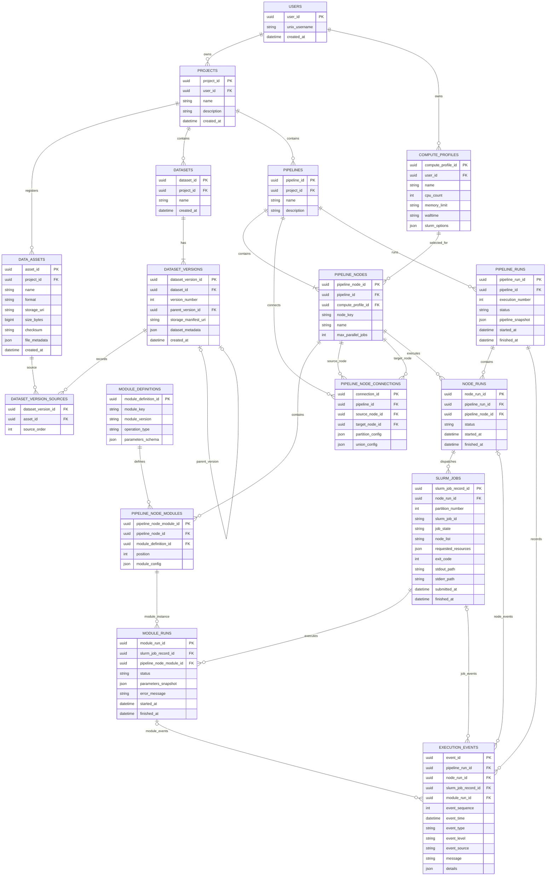
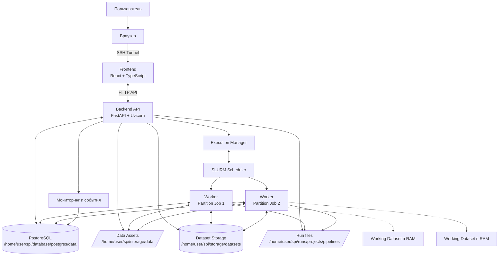

# Паспорт архитектуры — SPI

**Полное название:** Seismic Processing Interface  
**Версия:** 4.0
**Назначение:** архитектура MVP: frontend, backend, хранение данных, модель PostgreSQL и выполнение Pipeline на HPC с использованием SLURM.

---

## 1. Общая архитектура

SPI — персональная веб-платформа для организации и выполнения операций с сейсмическими данными на HPC.

Приложение и все его файлы размещаются в одном каталоге:

```text
/home/user/spi
```

Web App запускается под Unix-учётной записью пользователя. Пользователь открывает интерфейс в браузере через SSH Tunnel. Backend предоставляет API, работает с PostgreSQL и управляет вычислительными заданиями SLURM. Каждый вычислительный SLURM Job обрабатывает одну partition одного Pipeline Node.

Основные компоненты:

| Компонент | Назначение |
|---|---|
| Frontend | Интерфейс проектов, файлов, Dataset, Pipeline, вычислительных профилей и мониторинга |
| Backend API | Принимает запросы frontend, проверяет данные и вызывает прикладные сервисы |
| PostgreSQL | Хранит проекты, настройки, каталог Dataset, версии, Pipeline, состояния запусков и события |
| Dataset Storage | Хранит амплитуды, заголовки и структуру Dataset в собственном бинарном формате SPI |
| Execution Manager | Планирует Pipeline, создаёт Node Runs и SLURM Jobs, отслеживает их состояние |
| SLURM Worker | Выполняет последовательность модулей одного Pipeline Node для своей partition |

PostgreSQL и бинарные данные Dataset физически находятся внутри `/home/user/spi`. PostgreSQL хранит описание и связи Dataset; амплитудные массивы находятся в бинарных файлах Dataset Storage, а не в таблицах PostgreSQL.

## 2. Размещение файлов SPI

Всё файловое содержимое платформы размещается под `/home/user/spi`. Физические каталоги организованы по назначению: внешние файлы, внутренние Dataset, файлы запусков, база данных и временные данные.

```text
/home/user/spi/
├── frontend/
│   └── src/
├── backend/
├── database/
│   └── postgres/
│       └── data/                    # Файлы PostgreSQL (PGDATA)
├── storage/
│   ├── data/                        # Физические файлы Data Assets: исходные и экспортированные файлы
│   │   └── {project_id}/
│   └── datasets/                    # Внутренние бинарные Dataset и их версии
│       └── {project_id}/
│           └── {dataset_id}/
│               └── versions/
│                   └── {version_id}/ # Полное сохранённое состояние Dataset
├── runs/
│   └── projects/
│       └── pipelines/
│           └── {project_id}/
│               └── {pipeline_id}/
│                   └── {pipeline_run_id}/
│                       └── {pipelinenodename}_{executionnumber}_{partitionnumber}/
│                           ├── runtime.log  # Только пока SLURM Job выполняется
│                           ├── runinfo.log  # Итоговый отчёт после завершения SLURM Job
│                           ├── stdout.log   # SLURM stdout
│                           └── stderr.log   # SLURM stderr
├── tmp/                             # Временные файлы во время работы
└── config/                          # Конфигурация SPI
```

Таблица PostgreSQL сохраняет имя `data_assets`; изменяется только имя физического каталога: файлы Data Assets размещаются в `storage/data/`. Внутренние Dataset Versions размещаются в `storage/datasets/`. Фактическое разбиение одной версии Dataset на бинарные файлы ещё не фиксируется: каталог версии может содержать один или несколько файлов и индекс/манифест.

### 2.1. Правила размещения и жизненного цикла

- Исходные и экспортированные физические файлы, зарегистрированные как Data Assets, размещаются в `/home/user/spi/storage/data/{project_id}/`; сведения о них хранятся в таблице `data_assets`.
- Полные бинарные данные Dataset Versions размещаются в `/home/user/spi/storage/datasets/{project_id}/{dataset_id}/versions/{version_id}/`; PostgreSQL хранит идентичность, метаданные, версии и ссылки на физические данные.
- `PGDATA` размещается в `/home/user/spi/database/postgres/data`.
- Файлы запусков размещаются под `/home/user/spi/runs/projects/pipelines/{project_id}/{pipeline_id}/{pipeline_run_id}/`. Для каждой partition используется каталог `{pipelinenodename}_{executionnumber}_{partitionnumber}`.
- `runtime.log` доступен во время выполнения соответствующего SLURM Job. После завершения job временный `runtime.log` удаляется.
- После завершения каждого SLURM Job создаётся `runinfo.log`; он сохраняется независимо от результата выполнения.
- `stdout.log` и `stderr.log` сохраняются для диагностики SLURM Job. Отдельные логи модулей не создаются.
- Временные файлы размещаются в `/home/user/spi/tmp` и удаляются по правилам соответствующего процесса.

## 3. Потоки данных и типы операций

В MVP используются четыре типа операций. Они описывают направление переноса данных, а не научную функцию модуля.

| Тип операции | Направление | Основной модуль | Назначение |
|---|---|---|---|
| `import_dataset` | HPC → DB | `SEGYIN` + сохранение через `OUT` | Чтение внешнего SEG-Y, парсинг заголовков, формирование Working Dataset и сохранение первого внутреннего Dataset |
| `load_dataset` | DB → RAM | `IN` | Загрузка сохранённого Dataset или назначенной partition в оперативную память |
| `save_dataset` | RAM → DB | `OUT` | Сохранение полного Working Dataset, включая амплитуды, заголовки и структуру, как новой Dataset Version |
| `export_dataset` | DB → HPC | `SEGYOUT` | Чтение сохранённого Dataset и создание внешнего файла SEG-Y |

Здесь `DB` означает постоянное хранилище Dataset платформы: бинарные данные находятся в `/home/user/spi/storage/datasets`, а каталог, метаданные, версии и ссылки на физические данные — в PostgreSQL. Амплитудные массивы не записываются в таблицы PostgreSQL.

### 3.1. Роли модулей MVP

- **`SEGYIN`** читает зарегистрированный исходный SEG-Y, разбирает заголовки и считывает амплитуды. На время импорта формируется рабочее представление Dataset в RAM.
- **`IN`** загружает сохранённый Dataset или назначенную partition из внутреннего бинарного хранилища в RAM.
- **`OUT`** сохраняет полное текущее состояние Working Dataset в бинарное хранилище SPI и регистрирует новую Dataset Version в PostgreSQL. OUT не экспортирует SEG-Y.
- **`SEGYOUT`** читает сохранённый Dataset и формирует внешний SEG-Y. Экспортированный файл регистрируется как Data Asset.

Для MVP реализуются эти четыре модуля. FILTER, SORT, NORMALIZE, FOURIER и другие научные модули относятся к следующему этапу. Для них предусматривается будущий пользовательский тип вычислений RAM → RAM с возможностью прямой записи результата RAM → HPC (например, Artifact); такие пользовательские модули в MVP не поставляются.

### 3.2. Working Dataset и сохранённый Dataset

**Working Dataset** — рабочее представление Dataset в RAM вычислительного узла. Оно содержит реальные амплитудные массивы, заголовки трасс, технические метаданные и структуру/индексацию трасс. Последовательные модули одного SLURM Job работают с одним рабочим состоянием.

**Сохранённый Dataset** — полное содержимое Dataset во внутреннем бинарном формате SPI на диске. PostgreSQL хранит идентичность Dataset, версии, метаданные и расположение бинарных данных.

- `SEGYIN` формирует рабочее представление при импорте.
- `OUT` сохраняет его полное содержимое.
- `IN` загружает сохранённую версию или её partition в RAM.
- Последующие модули работают с Working Dataset.
- `OUT` сохраняет изменения как новую Dataset Version.
- `SEGYOUT` экспортирует сохранённую версию в SEG-Y.

## 4. Frontend

Frontend — одностраничное приложение React + TypeScript. Оно взаимодействует с системой только через Backend API. Frontend не обращается напрямую к PostgreSQL, файловой системе или SLURM.

Основные экраны:

- **Projects:** список, создание, переименование и открытие проектов.
- **Data Assets:** регистрация файлов, просмотр формата, размера, пути и технических метаданных.
- **Datasets:** список Dataset, версии и их метаданные.
- **Module Catalog:** доступные модули MVP, версии, описание и параметры.
- **Pipeline Editor:** граф Pipeline; добавление модулей и настройка их параметров; настройка `partition` и `union` на связях.
- **Compute Profiles:** выбор, создание, редактирование и сохранение профилей ресурсов пользователя.
- **Pipeline Run Monitor:** статусы Pipeline Run, Node Runs, Module Runs и SLURM Jobs; оперативный `runtime.log`; ссылки на `runinfo.log`, `stdout` и `stderr`.

Порядок модулей в Pipeline Node определяется порядком их добавления пользователем. Внутри одного SLURM Job модули выполняются последовательно. Мониторинг в MVP использует периодические запросы frontend к Backend API (polling); WebSocket не требуется.

### 4.1. Структура frontend

```text
frontend/
    src/
        app/
            App.tsx
            routes.tsx
        api/
            client.ts
            projects.ts
            dataAssets.ts
            datasets.ts
            modules.ts
            pipelines.ts
            computeProfiles.ts
            pipelineRuns.ts
            executionEvents.ts
        pages/
            ProjectsPage.tsx
            ProjectPage.tsx
            DataAssetsPage.tsx
            DatasetsPage.tsx
            PipelineEditorPage.tsx
            ComputeProfilesPage.tsx
            PipelineRunPage.tsx
        features/
            projects/
            data-assets/
            datasets/
            module-catalog/
            pipeline-editor/
            compute-profiles/
            run-monitor/
        components/
            layout/
            shared/
        hooks/
        types/
        utils/
        styles/
```

`api/` содержит функции Backend API; `pages/` — страницы; `features/` — функциональность отдельных разделов; `components/` — общие визуальные компоненты; `hooks/`, `types/`, `utils/` и `styles/` — общие frontend-механизмы.

## 5. Backend

Backend — Python + FastAPI/Uvicorn. SQLAlchemy 2.0 используется для работы с PostgreSQL; предпочтителен Async API, Sync API допустим, если он практичнее для конкретной части приложения.

Backend разделён на следующие части:

| Часть | Ответственность |
|---|---|
| API | HTTP endpoints и проверка входных запросов |
| Services | Прикладные сценарии проектов, Data Assets, Dataset, Pipeline и Compute Profiles |
| Database | SQLAlchemy models, repositories и транзакции PostgreSQL |
| Execution Manager | Планирование графа, создание запусков и управление SLURM Jobs |
| SLURM Adapter | Отправка заданий и получение их состояния через SLURM |
| Worker Runtime | Исполнение модулей внутри SLURM Job |
| Dataset I/O | Чтение и запись внутреннего бинарного Dataset |
| SEG-Y I/O | Импорт и экспорт SEG-Y |
| Monitoring | Запись Execution Events и формирование `runtime.log`/`runinfo.log` |

HTTP API не выполняет вычислительные алгоритмы. Backend проверяет запрос, сохраняет необходимые данные и поручает исполнение SLURM Job.

### 5.1. Структура backend

```text
backend/
    app/
        main.py
        api/
            router.py
            endpoints/
                projects.py
                data_assets.py
                datasets.py
                modules.py
                pipelines.py
                compute_profiles.py
                pipeline_runs.py
                execution_events.py
        core/
            config.py
            dependencies.py
        db/
            base.py
            session.py
            models/
            repositories/
        schemas/
        services/
            project_service.py
            data_asset_service.py
            dataset_service.py
            pipeline_service.py
            compute_profile_service.py
        execution/
            execution_manager.py
            graph_scheduler.py
            slurm_client.py
            slurm_monitor.py
            run_state_service.py
        runtime/
            job_entrypoint.py
            partition_worker.py
            module_runner.py
            working_dataset.py
        dataset/
            dataset_reader.py
            dataset_writer.py
            binary_format/
        segy/
            segy_reader.py
            segy_writer.py
        modules/
            registry.py
            definitions/
                segyin.py
                input.py
                output.py
                segyout.py
        monitoring/
            event_service.py
            runtime_log.py
            runinfo_log.py
            slurm_output.py
        storage/
            paths.py
            data_asset_store.py
            dataset_store.py
    migrations/
    tests/
    pyproject.toml
```

Структура показывает логические границы и может быть упрощена при реализации. Модули MVP зарегистрированы в `modules/definitions/`; `module_runner.py` запускает их по порядку в контексте одного partition job.

### 5.2. Execution Manager и SLURM Worker

**Execution Manager** работает в составе Backend и отвечает за оркестрацию:

1. Принимает команду запуска Pipeline.
2. Создаёт `PIPELINE_RUN` и сохраняет snapshot Pipeline, параметров модулей, связей, Compute Profiles и Partition/Union настроек.
3. Определяет готовые Pipeline Nodes и создаёт `NODE_RUN`.
4. Разбивает входной Dataset согласно `partition` на связи, если такая настройка задана.
5. Создаёт отдельный SLURM Job для каждой partition. Если разбиение не задано, создаётся один job для всего входа узла.
6. Ограничивает число одновременно активных jobs лимитом Pipeline Node. Ресурсы каждого job берутся из выбранного Compute Profile.
7. Отправляет задания в SLURM и сохраняет Job ID.
8. Отслеживает состояние заданий через SLURM и события Worker, обновляет PostgreSQL.
9. Запускает зависимые узлы после выполнения условий входящих связей, включая `union`, если он задан.

**Один SLURM Job выполняет одну partition на одном вычислительном узле.** Внутри job Worker последовательно выполняет все модули соответствующего Pipeline Node. Для каждого фактического запуска модуля создаётся `MODULE_RUN`.

Количество одновременно работающих jobs задаётся на уровне Pipeline Node. Пользователь выбирает Compute Profile с CPU, RAM и walltime одного job. Профили принадлежат пользователю и доступны во всех его Projects.

### 5.3. Ошибки и повторные запуски

- Ошибка одной partition не отменяет уже работающие jobs того же Node Run.
- После освобождения слота Execution Manager продолжает отправлять следующие partitions.
- После завершения всех обязательных partitions Node Run получает `failed`, если хотя бы одна partition завершилась неуспешно.
- Зависимый узел, которому нужен полный результат неуспешного Node Run, не запускается.
- Каждый повторный запуск создаёт новый `PIPELINE_RUN` и начинается с первого узла и первого модуля. Автоматического продолжения предыдущего запуска нет.
- Результаты и история предыдущих запусков не перезаписываются и автоматически не используются новым запуском.

## 6. Partition и Union в Pipeline

Разделение и объединение Dataset задаются настройками связей между Pipeline Nodes. Это не отдельные модули и не отдельные типы операций.

**Partition** на связи определяет, как входной Dataset разделяется на части. Например, таблица диапазонов `inline_start`–`inline_end` задаёт отдельные partitions. Каждая строка таблицы соответствует одному SLURM Job целевого Node Run.

**Union** на связи определяет, что результаты нескольких upstream partitions передаются целевому узлу как один логический Dataset. Целевой узел с `union` ожидает завершения всех обязательных upstream jobs. Он может работать с логическим набором частей без обязательного предварительного копирования их в один физический файл.

Пример структуры Pipeline:

```text
Node 1: SEGYIN -> OUT
    |
    | connection: partition
    v
Node 2: IN -> OUT
    |
    | connection: union
    v
Node 3: SEGYOUT
```

Это схема движения данных. Фактический набор модулей конкретного узла определяется его конфигурацией. Внутренняя организация бинарных partition-частей и манифеста логического Dataset остаётся отдельной задачей проектирования.

## 7. PostgreSQL — таблицы и назначение

PostgreSQL хранит структуру приложения, каталог Dataset и историю выполнения. Физические Data Assets находятся в `/home/user/spi/storage/data`, а амплитуды, заголовки и структура сохранённых Dataset — в `/home/user/spi/storage/datasets`.

| Таблица | Назначение |
|---|---|
| `users` | Персональная учётная запись пользователя SPI и его `unix_username` |
| `projects` | Персональные проекты пользователя |
| `compute_profiles` | Сохранённые пользователем профили ресурсов SLURM (CPU, RAM, walltime и другие разрешённые параметры) |
| `data_assets` | Зарегистрированные внешние файлы проекта: исходные и экспортированные SEG-Y; физические файлы размещаются в `/home/user/spi/storage/data/{project_id}/` |
| `datasets` | Стабильная идентичность логического Dataset в проекте |
| `dataset_versions` | Неизменяемые сохранённые состояния Dataset; содержат номер версии, метаданные и ссылку на бинарное представление/манифест |
| `dataset_version_sources` | Связи Dataset Version с исходными Data Assets и порядок источников; в MVP импорт использует один исходный SEG-Y на Dataset |
| `module_definitions` | Реестр модулей и версий; в MVP — `SEGYIN`, `IN`, `OUT`, `SEGYOUT` |
| `pipelines` | Сохранённые схемы Pipeline проекта |
| `pipeline_nodes` | Узлы Pipeline; включают выбранный Compute Profile и лимит параллельных jobs |
| `pipeline_node_modules` | Модули узла, порядок их выполнения и конфигурация параметров |
| `pipeline_node_connections` | Направленные связи между узлами; содержат настройки `partition` и `union` |
| `pipeline_runs` | Конкретные запуски Pipeline, статус, номер запуска и snapshot конфигурации |
| `node_runs` | Выполнение конкретного Pipeline Node в рамках Pipeline Run |
| `slurm_jobs` | SLURM Job ID, Node Run, номер partition, ресурсы, состояние, вычислительный узел и пути `stdout`/`stderr` |
| `module_runs` | Фактический запуск каждого модуля внутри конкретного SLURM Job/partition |
| `execution_events` | Хронология событий Pipeline Run, Node Run, Module Run и SLURM Job |

Физический каталог `/home/user/spi/storage/data/` называется `data`, но таблица PostgreSQL остаётся `data_assets`. Переименование каталога не меняет имя таблицы и её назначение.

### 7.1. Что не входит в модель MVP

- `sessions` — Session не используется.
- `dataset_transformations` — отдельная таблица преобразований не нужна; состав Pipeline фиксируется в snapshot, фактическое исполнение — в Module Runs и Execution Events.
- `artifacts` — самостоятельные Artifact outputs пользовательских вычислительных модулей отложены за пределы MVP.
- Отдельная таблица `module_versions` не нужна: версия хранится в `module_definitions`.

### 7.2. Основные связи

- `users` 1:N `projects`.
- `users` 1:N `compute_profiles`.
- `projects` 1:N `data_assets`, `datasets`, `pipelines`.
- `datasets` 1:N `dataset_versions`.
- `dataset_versions` N:M `data_assets` через `dataset_version_sources`.
- `pipelines` 1:N `pipeline_nodes`, `pipeline_node_connections` и `pipeline_runs`.
- `pipeline_nodes` 1:N `pipeline_node_modules` и `node_runs`.
- `module_definitions` 1:N `pipeline_node_modules`.
- `pipeline_node_connections` связывает два `pipeline_nodes` одного Pipeline.
- `pipeline_runs` 1:N `node_runs`.
- `node_runs` 1:N `slurm_jobs`.
- `slurm_jobs` 1:N `module_runs`.
- `pipeline_node_modules` 1:N `module_runs`.
- `execution_events` относятся к Pipeline Run и при необходимости к Node Run, SLURM Job и Module Run.

## 8. Mermaid ER-диаграмма



## 9. Mermaid диаграмма компонентов и выполнения




## 10. Мониторинг и логи

- Источник структурированных данных для мониторинга — таблица `execution_events`; текущие состояния хранятся в соответствующих таблицах запусков и SLURM Jobs.
- `runtime.log` отображает события текущего SLURM Job во время его выполнения. После завершения job файл удаляется.
- `runinfo.log` создаётся сразу после завершения каждого SLURM Job, независимо от состояния остальных partitions. В нём собраны параметры запуска, partition, последовательность модулей, времена, итоговый статус, сведения SLURM и ошибки.
- Имя каталога для конкретного задания: `{pipelinenodename}_{executionnumber}_{partitionnumber}`. Каталоги запусков размещаются внутри `/home/user/spi/runs/projects/pipelines/{project_id}/{pipeline_id}/{pipeline_run_id}/`.
- `stdout` и `stderr` сохраняются для диагностики процесса и SLURM. Отдельные module logs не создаются.
- Если Worker завершился аварийно и не успел записать `runinfo.log`, отчёт формирует Execution Manager по `execution_events` и состоянию SLURM.
- После перезапуска Web App Execution Manager восстанавливает историю из PostgreSQL и сверяет активные Job ID с SLURM. Наличие или отсутствие лог-файла не определяет статус задания.

## 11. Ограничения MVP и вопросы реализации

В MVP:

- один пользователь работает со своими Projects под собственной Unix-учётной записью;
- совместное владение проектами несколькими пользователями и Session отсутствуют;
- основной внешний формат — SEG-Y; ограничение по размерности данных определяется паспортом проекта;
- постоянный Dataset хранится в собственном бинарном формате SPI;
- реализуются `SEGYIN`, `IN`, `OUT`, `SEGYOUT`;
- отдельные научные модули FILTER, SORT, FOURIER и пользовательские RAM → RAM модули не входят в MVP;
- Artifact outputs пользовательских модулей отложены за пределы MVP;
- визуализация амплитуд и заголовков в интерфейсе не входит в MVP;
- повторный запуск всегда создаёт новый Pipeline Run с начала.

Открытые технические вопросы:

1. Структура собственного бинарного формата: один файл или набор файлов, манифест, блоки амплитуд, заголовки и индексы.
2. Физическое представление нескольких partition-частей одной Dataset Version и правила публикации логического результата после `union`.
3. Проверка Partition Definition: пересечения, пропуски, полнота диапазонов и отсутствующие SEG-Y headers.
4. Проверка ограничений Compute Profiles и доступного числа одновременно выполняемых jobs.
5. Механизм, гарантирующий размещение одновременно выполняемых partition jobs на разных физических вычислительных узлах.
6. Поведение независимых ветвей Pipeline при ошибке одного Node Run.
7. Точная схема входов/выходов Pipeline Nodes и необходимость явных портов на связях.
8. Контракт и правила безопасности для пользовательских RAM → RAM модулей будущего этапа.

---

## 12. Связанные документы

- `Паспорт проекта — MVP` — функциональные требования и границы MVP.
- `operation_types.md` — направления переноса данных и назначение четырёх типов операций MVP.
