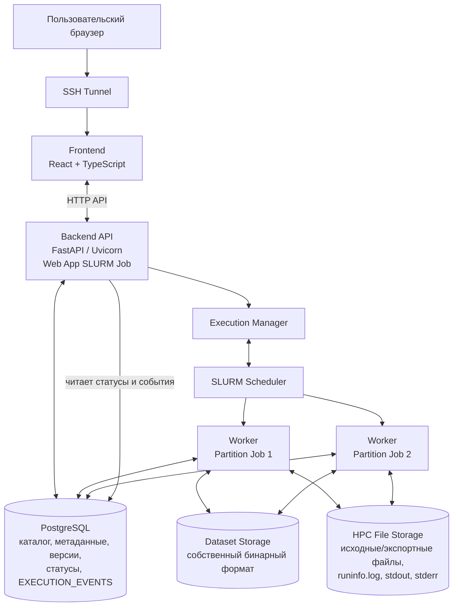
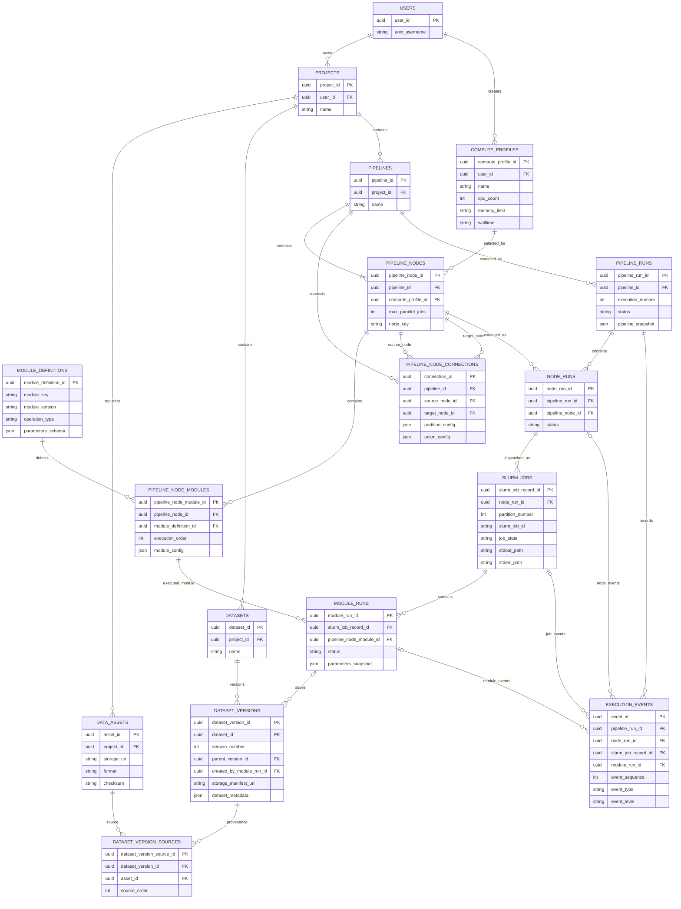

# Паспорт архитектуры — модульная платформа обработки сейсмических данных на HPC

**Версия:** 4.0 (рабочая)  
**Назначение:** описание архитектуры MVP, структуры frontend/backend, модели данных и взаимодействия с HPC/SLURM.

## 1. Архитектурная схема верхнего уровня

Система состоит из браузерного frontend, backend API, PostgreSQL, внутреннего бинарного хранилища Dataset и вычислительных SLURM Jobs.

- **Frontend:** React + TypeScript. Отвечает за проекты, Data Assets, Dataset, редактор Pipeline, Compute Profiles и мониторинг запусков.
- **Backend:** Python + FastAPI/Uvicorn. Предоставляет API, управляет проектами и Pipeline, записывает метаданные в PostgreSQL и передаёт вычислительную работу SLURM.
- **Execution Manager:** часть backend. Создаёт Pipeline Run/Node Run, разбирает граф, формирует partition jobs, отправляет их в SLURM и отслеживает выполнение.
- **Worker:** запускается внутри каждого вычислительного SLURM Job. Один job обрабатывает одну partition и выполняет последовательность модулей соответствующего Pipeline Node.
- **PostgreSQL:** хранит каталог и идентичность объектов, метаданные Dataset и Data Assets, версии, связи Pipeline, состояния выполнения и `EXECUTION_EVENTS`.
- **Dataset Storage:** постоянное файловое хранилище собственного бинарного формата Dataset на HPC. Содержит амплитудные массивы, заголовки и структуру данных. Это не таблицы PostgreSQL.
- **External HPC File Storage:** хранит исходные SEG-Y, экспортированные SEG-Y, `runinfo.log`, `stdout` и `stderr`.

Web App запускается под Unix-учётной записью пользователя как отдельное веб-задание на HPC. Пользователь открывает его через браузер, обычно через SSH Tunnel. Вычислительные jobs отделены от Web App и отправляются через SLURM.

## 2. Компонентная и исполнительная архитектура



### 2.1. Frontend

Frontend — одностраничное React-приложение на TypeScript. Оно не читает HPC-файлы напрямую и не взаимодействует со SLURM. Все операции выполняются через Backend API.

Основные разделы интерфейса:

- **Projects:** список и управление персональными проектами.
- **Data Assets:** регистрация и просмотр внешних файлов на HPC.
- **Datasets:** просмотр Dataset, версий и технических метаданных.
- **Module Catalog:** доступные в MVP модули и их параметры.
- **Pipeline Editor:** граф Pipeline, редактирование состава и порядка модулей узла, параметры модулей и настройки `partition`/`union` на связях.
- **Compute Profiles:** выбор, создание и сохранение профилей пользователя.
- **Pipeline Run Monitor:** статусы Pipeline Run, Node Runs, Module Runs и SLURM Jobs, `runtime.log`, ссылки на `runinfo.log`, `stdout` и `stderr`.

Для MVP мониторинг обновляется периодическими запросами к API (polling), ориентировочно каждые 2–3 секунды. WebSocket не является обязательным условием MVP. Интервал обновления задаётся конфигурацией frontend/backend.

### 2.2. Backend

Backend построен на FastAPI/Uvicorn и SQLAlchemy 2.0. Для SQLAlchemy предпочтителен Async API; Sync API допустим, если он упрощает реализацию или лучше подходит выбранным библиотекам. API-слой принимает запросы frontend, проверяет входные данные и вызывает сервисы. Вычислительные алгоритмы не выполняются внутри HTTP-запросов.

Ключевые компоненты:

- **API layer:** REST endpoints для Projects, Data Assets, Datasets, модулей, Pipelines, Compute Profiles, запусков, событий и логов.
- **Application services:** прикладные сценарии регистрации файлов, импорта/загрузки/сохранения/экспорта Dataset, редактирования Pipeline и запуска Pipeline Run.
- **Database layer:** SQLAlchemy models/repositories и PostgreSQL session management.
- **Execution Manager:** анализирует граф, проверяет зависимости, создаёт записи запусков, подготавливает jobs и контролирует их состояние.
- **SLURM adapter:** отправляет jobs и получает состояние через доступные команды/интерфейсы SLURM (например, `sbatch`, `squeue`, `sacct`).
- **Partition Worker:** точка входа вычислительного SLURM Job. Получает snapshot запуска и параметры своей partition, выполняет назначенную последовательность модулей.
- **Module Registry/Runner:** предоставляет определения модулей MVP и запускает их последовательно в одном runtime-контексте job.
- **Dataset Reader/Writer:** читает/пишет собственный бинарный Dataset и формирует Working Dataset в RAM.
- **SEG-Y Reader/Writer:** парсит входные SEG-Y и экспортирует сохранённый Dataset в SEG-Y.
- **Event/Log service:** записывает структурированные события, обеспечивает оперативное представление `runtime.log` и формирует постоянный `runinfo.log`.

### 2.3. SLURM и выполнение partition jobs

1. Пользователь запускает Pipeline через frontend.
2. Backend создаёт `PIPELINE_RUN` и сохраняет snapshot схемы, параметров, связей, Compute Profiles и Partition/Union config.
3. Execution Manager определяет готовые Pipeline Nodes и создаёт `NODE_RUN`.
4. Для каждой partition формируется отдельный SLURM Job. Если разбиение не задано, узел может выполняться одним job для всего назначенного Dataset.
5. Один SLURM Job обрабатывает одну partition на одном вычислительном узле. Внутри job модули Pipeline Node выполняются последовательно в порядке добавления.
6. Количество одновременно активных jobs ограничивается настройкой Pipeline Node. Ресурсы одного job берутся из выбранного Compute Profile.
7. Worker обновляет статусы Module Runs/SLURM Job и записывает `EXECUTION_EVENTS`.
8. После завершения каждого job формируется `runinfo.log` для его partition независимо от остальных jobs.
9. Если одна partition завершается с ошибкой, остальные jobs не отменяются; новые jobs продолжают отправляться по мере освобождения слотов. Node Run становится `failed`, если хотя бы одна обязательная partition завершилась неуспешно.
10. Узел-получатель с настройкой `union` запускается только после успешного завершения всех upstream partition jobs, необходимых для его входного Dataset.

### 2.4. Мониторинг и журналы

- Статусы `PIPELINE_RUNS`, `NODE_RUNS`, `MODULE_RUNS` и `SLURM_JOBS` хранятся в PostgreSQL и не выводятся только из лог-файлов.
- `EXECUTION_EVENTS` — структурированная хронология событий и основа мониторинга.
- `runtime.log` доступен во время работы SLURM Job и строится/обновляется на основе событий. После завершения job интерфейс показывает сообщение о завершении и предлагает открыть `runinfo.log`.
- `runinfo.log` создаётся после завершения каждого partition job, в том числе при ошибке, в каталоге `{pipelinenodename}_{executionnumber}_{partitionnumber}`.
- `stdout` и `stderr` — отдельные системные потоки SLURM Job. Они сохраняются для диагностики процесса, окружения и вычислительного узла.
- Отдельные module logs в MVP не создаются.
- После перезапуска Web App состояние восстанавливается из PostgreSQL; активные Job ID сверяются с состоянием SLURM. Логи не являются источником истины о статусе.

## 3. Frontend — структура каталогов

```text
frontend/
    src/
        app/
            App.tsx
            routes.tsx
        api/
            client.ts
            projects.ts
            dataAssets.ts
            datasets.ts
            modules.ts
            pipelines.ts
            computeProfiles.ts
            pipelineRuns.ts
            executionEvents.ts
        pages/
            ProjectsPage.tsx
            ProjectPage.tsx
            DataAssetsPage.tsx
            DatasetsPage.tsx
            PipelineEditorPage.tsx
            ComputeProfilesPage.tsx
            PipelineRunPage.tsx
        features/
            projects/
            data-assets/
            datasets/
            module-catalog/
            pipeline-editor/
            compute-profiles/
            run-monitor/
        components/
            layout/
            shared/
        hooks/
        types/
        utils/
        styles/
```

Назначение основных частей:

- `app/` — сборка приложения и маршрутизация.
- `api/` — типизированные функции обращения к Backend API.
- `pages/` — страницы верхнего уровня.
- `features/` — интерфейсные сценарии конкретных доменов.
- `components/` — общие компоненты и элементы компоновки.
- `hooks/`, `types/`, `utils/`, `styles/` — повторно используемая логика, типы, утилиты и стили.

Внутри одного экрана Pipeline Editor пользователь редактирует состав и порядок модулей Pipeline Node и их параметры. Параметры `partition` и `union` настраиваются на соответствующих связях графа.

## 4. Backend — структура каталогов

```text
backend/
    app/
        main.py
        api/
            router.py
            endpoints/
                projects.py
                data_assets.py
                datasets.py
                modules.py
                pipelines.py
                compute_profiles.py
                pipeline_runs.py
                execution_events.py
        core/
            config.py
            dependencies.py
            security.py
        db/
            base.py
            session.py
            models/
            repositories/
        schemas/
        services/
            project_service.py
            data_asset_service.py
            dataset_service.py
            pipeline_service.py
            compute_profile_service.py
        execution/
            execution_manager.py
            graph_scheduler.py
            slurm_client.py
            slurm_monitor.py
            run_state_service.py
        runtime/
            job_entrypoint.py
            partition_worker.py
            module_runner.py
            working_dataset.py
            dataset_reader.py
            dataset_writer.py
        storage/
            dataset_store.py
            data_asset_store.py
            binary_format/
            segy_reader.py
            segy_writer.py
            log_store.py
        modules/
            registry.py
            definitions/
                segyin.py
                input.py
                output.py
                segyout.py
        events/
            event_service.py
            runtime_log.py
            runinfo_log.py
    migrations/
    tests/
    pyproject.toml
```

Это логическая структура проекта, а не обязательное требование к каждому физическому Python-файлу. При реализации её можно немного упростить, сохраняя разделение API, сервисов, БД, исполнения, runtime и хранения.

## 5. Типы операций и Dataset lifecycle

В MVP используются четыре типа операций. Полное описание находится в отдельном файле `operation_types.md`.

| Тип | Направление | Назначение |
|---|---|---|
| `import_dataset` | HPC → DB | Импорт внешнего SEG-Y во внутренний Dataset. `SEGYIN` читает/парсит файл и формирует Working Dataset; `OUT` сохраняет его в бинарное хранилище и регистрирует Dataset Version. RAM — временный этап импорта. |
| `load_dataset` | DB → RAM | `IN` загружает сохранённый Dataset или partition в Working Dataset. |
| `save_dataset` | RAM → DB | `OUT` сохраняет полное текущее состояние Working Dataset, включая амплитуды, заголовки и структуру, как новую Dataset Version. |
| `export_dataset` | DB → HPC | `SEGYOUT` экспортирует сохранённый Dataset во внешний SEG-Y. |

`DB` здесь — постоянное хранилище Dataset платформы на HPC плюс его PostgreSQL-каталог. Амплитудные массивы находятся в собственных бинарных файлах, а не в PostgreSQL.

Dataset имеет два состояния:

- **Persistent Dataset / Dataset Version:** полные амплитуды, заголовки и структура в постоянном бинарном хранилище HPC; PostgreSQL содержит идентификаторы, метаданные, версии и ссылки.
- **Working Dataset:** те же данные, загруженные в RAM вычислительного узла на время выполнения job.

## 6. Настройки Partition и Union

`partition` и `union` — настройки `PIPELINE_NODE_CONNECTIONS`, а не самостоятельные модули.

- `partition` задаёт разбиение Dataset по значениям заголовков, например диапазонами или таблицей групп. Одна строка разбиения соответствует одной partition и одному SLURM Job целевого Node Run.
- `union` сообщает целевому узлу, что несколько upstream partition-результатов должны быть представлены как один логический Dataset после успешного завершения требуемых jobs.
- Модули `IN`, `OUT`, `SEGYIN`, `SEGYOUT` не должны самостоятельно управлять графом или планировать другие jobs.
- Физическая организация partition-частей в бинарном хранилище и формат манифеста union остаются предметом отдельного проектирования.

## 7. Модель данных PostgreSQL

PostgreSQL хранит структурированные данные и каталог Dataset Storage. Он **не хранит сами амплитудные массивы**.

| Таблица | Назначение |
|---|---|
| `users` | Персональная кластерная учётная запись пользователя приложения (`unix_username`). |
| `projects` | Персональные проекты пользователя. |
| `compute_profiles` | Профили ресурсов SLURM, принадлежащие пользователю и доступные во всех его Projects. |
| `data_assets` | Внешние физические файлы на HPC, зарегистрированные в проекте: входные и экспортированные SEG-Y. |
| `datasets` | Стабильная идентичность логического Dataset в проекте. |
| `dataset_versions` | Неизменяемые версии Dataset; содержат номер версии, при необходимости ссылку на родительскую версию, `storage_manifest_uri`, формат/версию бинарного хранилища, метаданные и связь с Module Run `OUT`, который сохранил результат. |
| `dataset_version_sources` | Связи Dataset Version с Data Assets, использованными как исходные данные, для provenance. |
| `module_definitions` | Реестр определений модулей и их версий; для MVP — `SEGYIN`, `IN`, `OUT`, `SEGYOUT`. |
| `pipelines` | Сохранённые схемы Pipeline. |
| `pipeline_nodes` | Логические узлы Pipeline; содержат ссылку на Compute Profile и лимит параллельных jobs. |
| `pipeline_node_modules` | Модули внутри узла, их порядок добавления и конфигурация. |
| `pipeline_node_connections` | Направленные связи Pipeline Nodes; здесь хранятся `partition_config` и `union_config` (например, JSONB). |
| `pipeline_runs` | Конкретные запуски Pipeline, статусы, порядковый номер запуска и snapshot графа/параметров. |
| `node_runs` | Фактические выполнения Pipeline Nodes в рамках Pipeline Run. |
| `slurm_jobs` | SLURM Job ID, `node_run_id`, номер partition, параметры разбиения, ресурсы, состояние, узел и пути `stdout`/`stderr`. |
| `module_runs` | Фактические выполнения отдельных модулей внутри конкретного SLURM Job/partition. |
| `execution_events` | Структурированные события Pipeline Run, Node Run, Module Run и SLURM Job. |

### 7.1. Намеренно отсутствующие таблицы MVP

- `sessions` — Session исключена из модели.
- `dataset_transformations` — отдельная таблица цепочки преобразований не требуется: состав и ход исполнения фиксируются через Pipeline snapshot, Module Runs и Execution Events.
- `artifacts` — самостоятельные Artifact outputs пользовательских RAM-модулей отложены за пределы MVP.
- отдельная `module_versions` не требуется, если каждая версия хранится отдельной записью `module_definitions` с полем `module_version`.

### 7.2. Ключевые связи

- `users` 1:N `projects`.
- `users` 1:N `compute_profiles`.
- `projects` 1:N `data_assets`, `datasets`, `pipelines`.
- `datasets` 1:N `dataset_versions`.
- `dataset_versions` N:M `data_assets` через `dataset_version_sources` (в MVP обычно один исходный Data Asset на импортируемый Dataset).
- `pipelines` 1:N `pipeline_nodes` и `pipeline_node_connections`.
- `pipeline_nodes` 1:N `pipeline_node_modules`; `module_definitions` 1:N `pipeline_node_modules`.
- `pipelines` 1:N `pipeline_runs`; `pipeline_runs` 1:N `node_runs`.
- `node_runs` 1:N `slurm_jobs`; `slurm_jobs` 1:N `module_runs`.
- `pipeline_node_modules` 1:N `module_runs`; `module_runs` 1:N `dataset_versions` для версий, сохранённых через `OUT`.
- `execution_events` связаны с Pipeline Run и при необходимости с Node Run, Module Run и SLURM Job.

## 8. Mermaid ER-диаграмма



## 9. Физическое хранение и развёртывание

| Компонент | Физическое размещение | Содержание |
|---|---|---|
| PostgreSQL `PGDATA` | Постоянное дисковое хранилище HPC или предоставленный администратором DB service | Файлы PostgreSQL, таблицы, индексы, WAL. Не RAM. |
| Dataset Storage | Постоянная файловая система HPC | Внутренний бинарный формат Dataset: амплитуды, заголовки, метаданные и части/индексы. |
| Data Asset Storage | Файловая система HPC | Исходные и экспортированные внешние файлы, например SEG-Y. |
| Working Dataset | RAM вычислительного узла | Амплитуды и метаданные, загруженные для текущего SLURM Job/partition. |
| `runtime.log` | Временное хранилище текущего выполнения | Оперативное представление событий до завершения соответствующего job. |
| `runinfo.log` | Постоянное файловое хранилище HPC | Итоговый отчёт после завершения каждого partition job. |
| `stdout` / `stderr` | Файловая система HPC, настроенная для SLURM | Системный вывод и ошибки процесса/job. |

Расположение PostgreSQL service и `PGDATA` пока не зафиксировано: доступность готового сервиса и подходящего места хранения необходимо подтвердить у администраторов; наличие пользовательского доступа к PostgreSQL Server пока не подтверждено. Пользователь не предполагается имеющим административные права на HPC. Не следует размещать `PGDATA` на NFS без подтверждения корректности locking/fsync и гарантий файловой системы. Dataset Storage также должен находиться на постоянном файловом хранилище, доступном нужным вычислительным заданиям. По имеющейся информации верхний предел памяти на одну задачу может достигать 1100 GB, но это не означает, что каждый job сможет получить такой объём: фактические ресурсы определяются Compute Profile, политиками SLURM и доступностью ресурсов. Контейнеризация через Apptainer не является обязательной зависимостью MVP и может рассматриваться позднее.

## 10. Открытые архитектурные вопросы

1. Физическая структура собственного бинарного формата Dataset: один файл или набор файлов, манифест, индексы и организация блоков амплитуд.
2. Физическая организация нескольких partition-частей и публикация логического Dataset при `union`.
3. Совместимость прежнего MVP scope (2D) с примерами 3D SEG-Y и `inline` partitions.
4. Проверка Partition Definition: пересечения, пропуски, полнота покрытия и отсутствующие заголовки.
5. Гарантия размещения partition jobs на разных физических узлах SLURM (`--exclusive` или другой механизм).
6. Поведение независимых ветвей Pipeline при ошибке одной ветви. Для partitions внутри одного Node Run согласовано: остальные jobs продолжаются, новые jobs отправляются по мере освобождения слотов.
7. Конкретные ограничения Compute Profiles на целевом кластере.
8. Фактический способ предоставления PostgreSQL Server и место `PGDATA`.
9. Аутентификация Web App и защита локального порта/SSH Tunnel.
10. Нужны ли явные адресуемые input/output ports на связях Pipeline.
11. Технический контракт и изоляция пользовательских RAM → RAM модулей будущего этапа.

## 11. Архитектурные ограничения MVP

- Один пользователь работает со своими Projects под своей Unix-учётной записью HPC.
- Web App и вычислительные SLURM Jobs разделены.
- В одном SLURM Job одна partition и последовательная цепочка модулей одного Pipeline Node.
- Compute Profile задаёт ресурсы одного job; максимальное число одновременно активных jobs задаётся отдельно на Pipeline Node.
- `OUT` сохраняет амплитуды и остальные данные Working Dataset в собственный бинарный Dataset Storage; PostgreSQL не хранит амплитудные массивы.
- `SEGYOUT` создаёт внешний SEG-Y Data Asset; `OUT` не является экспортом SEG-Y.
- Для каждой завершившейся partition формируется собственный `runinfo.log`; `runtime.log` доступен только пока job выполняется.
- Повторный запуск создаёт новый Pipeline Run с начала; автоматическое продолжение и автоматическое переиспользование выходов предыдущего запуска не выполняются.
